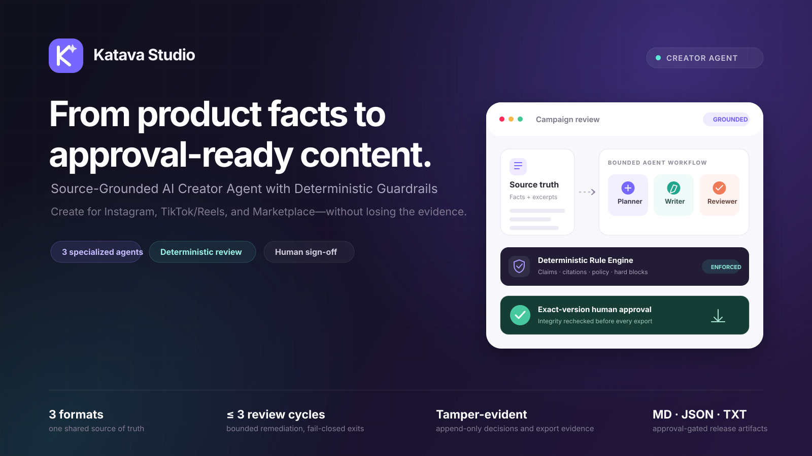
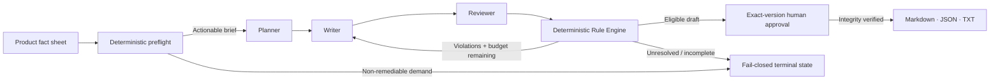

<div align="center">
  

  # Katava Studio

  ### Source-Grounded AI Creator Agent with Deterministic Guardrails

  Turn one product fact sheet into Instagram captions, TikTok/Reels scripts, and Marketplace listings—then review the evidence, remediate violations, and export only the exact version a human approved.

  **Built for Tencent Cloud Hackathon Indonesia 2026 · Challenge C: The Creator Agent**

  
</div>

## Judge Fast Track

| Action | Start here |
| --- | --- |
| **Open the live application** | [**Launch Katava Studio →**](https://katava-studio.apps.workbuddy.host/?sharecode=V4GFDFSY2Z) |
| **Take the 90-second walkthrough** | [**See the product flow ↓**](#see-it-in-action--90-second-walkthrough) |
| **Watch the demo video** | `Pending final recording` — replace this line with the published video URL |
| **Open the accountability sheet** | `Pending final submission artifact` — add the final document and link it here |
| **Inspect verification evidence** | [**Browse the test suite →**](https://github.com/ralvyathaya/katava-studio/tree/main/tests) · Run `npm test` |

<div align="center">


</div>

## Create with evidence, not guesswork

Katava Studio treats the product sheet as the source of truth. Three specialized agents produce structured work, while a deterministic Rule Engine independently checks every draft. A positive model verdict cannot bypass a hard rule, and a passing draft cannot be exported until a person approves that exact content version.

- **Three output formats, one campaign:** every format cites the same persisted source facts and resolved excerpts.
- **Real agent execution:** Planner, Writer, and Reviewer are separate model calls with schema-validated outputs—not scripted demo responses.
- **Bounded remediation:** up to three review cycles, transient retry limited to two total attempts, and a 90-second per-item deadline after queue admission.
- **A release gate, not a publish button:** approved versions export to Markdown, JSON, or plain text. Katava does not publish to social media.

## Responsible AI by Architecture



### 1. Deterministic preflight

The brief is checked before model execution. Demands that conflict with mandatory policy are escalated instead of being passed to an agent for cosmetic remediation. Source facts retain stable IDs and excerpts so generated claims can be traced back to supplied evidence.

### 2. Three agents, bounded review

**Planner → Writer → Reviewer** have separate responsibilities and structured output contracts. The Rule Engine evaluates claims, citations, and policy independently; a Reviewer `PASS` never overrides a deterministic hard block. Timeout, transport failure, malformed output, or exhausted remediation ends in an explicit fail-closed state rather than a fabricated success.

### 3. Exact-version human approval

A private review link grants a scoped decision on one immutable content version. Approval is bound to content, source facts, policy, and Reviewer evidence. Editing creates a new unreviewed version and invalidates the previous approval; replayed decisions cannot overwrite history.

### 4. Tamper-evident release evidence

Every export rechecks version and approval integrity before creating an artifact. Agent activity, findings, citations, decisions, and exports are retained as append-only audit evidence. Opening a review page never approves content, and exporting never publishes it.

> **Policy scope:** `KATAVA-DEMO-GUARDRAILS` v0.1 is an internal demonstration rulebook with six deterministic rules. It is not Indonesian law, BPOM guidance, halal certification, or legal advice. Human approval records a link-holder decision, not verified customer identity.

## See It In Action · 90-Second Walkthrough

| Time | Product moment | What to look for |
| --- | --- | --- |
| **00:00–00:15** | **01 · Input Brief** | Paste a product sheet and select Instagram, TikTok/Reels, or Marketplace. The source facts and excerpts remain inspectable. |
| **00:15–00:30** | **02 · Policy Violation Caught** | Show a deterministic finding with its rule, evidence, and location. A model cannot vote away a hard block. |
| **00:30–00:50** | **03 · Auto-Remediation** | Follow Writer revisions and Reviewer activity through the bounded loop. Invalid or incomplete output stops instead of becoming a false `PASS`. |
| **00:50–01:10** | **04 · Operator Sign-off** | Issue a private review link, inspect the exact version and citations, then explicitly approve, reject, or request changes. |
| **01:10–01:30** | **05 · Gated Export** | Download Markdown, JSON, or text only after approval, then show the recorded audit event and `published: false` export metadata. |

### Product captures

Add final captures at the paths below, then uncomment each image. Keeping these placeholders visible avoids presenting mock screens as real product evidence.

<!--
#### Input Brief


#### Policy Violation Caught


#### Auto-Remediation


#### Operator Sign-off and Gated Export

-->

**Demo video:** pending final recording. A useful final cut pairs the walkthrough above with the live application, not a prerecorded or mocked agent result.

## Quick Start

### Prerequisites

Node.js 20+, npm, and an OpenAI-compatible chat-completions API key.

### 1. Install and configure

```bash
git clone https://github.com/ralvyathaya/katava-studio.git
cd katava-studio
npm install
cp .env.example .env
```

Set `OPENAI_API_KEY` in `.env`. Optional gateway and model settings are documented in [`docs/LLM_SETUP.md`](docs/LLM_SETUP.md).

### 2. Prepare the database and approval key

```bash
npm run db:push
npm run db:seed
npm run setup:approval
```

Use these database commands for a fresh local database. The seed is not idempotent; do not reset a database containing evidence you need to keep. `setup:approval` configures a manager key separate from the model credential.

### 3. Verify and launch

```bash
npm run verify:llm
npm run dev
```

Open **http://localhost:3000**. Generate a fresh draft, issue a review link from the approval controls, and use the separate manager key when requested. Review links are sensitive credentials; their raw bearer token is kept in the URL fragment and only its hash is stored.

## Verify the Contracts

```bash
npm test
npx tsc --noEmit
npm run lint
npm run build
```

- **116 deterministic tests** cover the pipeline, rule engine, bounded retry, approval integrity, security controls, edit invalidation, and export gates.
- Live integration tests are opt-in with `KATAVA_RUN_LIVE_LLM_TESTS=1 npm test` and require a working model connection.
- The 90-second limit applies to each item after queue admission; two items execute concurrently and a third waits.
- Production generation streams NDJSON progress events. Test transports are injected only in tests and are not a production fallback.

## Technology

| Layer | Implementation |
| --- | --- |
| Application | Next.js 16 App Router · React 19 · TypeScript strict · Tailwind CSS 4 |
| Agent pipeline | Planner · Writer · Reviewer · Zod-validated structured output |
| Policy | Six deterministic demo rules · bounded remediation · fail-closed outcomes |
| Persistence | Prisma 6 · SQLite · append-only audit and export records |
| Approval | Exact-version integrity bindings · scoped bearer review links · atomic decisions |
| Verification | Node test runner via `tsx` · strict TypeScript · ESLint |

## Explore the Implementation

| Path | Responsibility |
| --- | --- |
| [`lib/orchestrator.ts`](lib/orchestrator.ts) | Bounded review loop, escalation, and passing-state persistence |
| [`lib/generation.ts`](lib/generation.ts) | Multi-format scheduling, deadlines, and independent results |
| [`lib/llm-adapter.ts`](lib/llm-adapter.ts) | Real model transport, timeout composition, and bounded transient retry |
| [`lib/rules/`](lib/rules/) | Deterministic preflight and content review |
| [`lib/approval-service.ts`](lib/approval-service.ts) | Exact-version links, decisions, integrity, and edit invalidation |
| [`lib/export-service.ts`](lib/export-service.ts) | Approval-gated artifacts and export evidence |
| [`app/page.tsx`](app/page.tsx) | Creator workflow and live generation progress |
| [`app/review/`](app/review/) | Private client review and explicit confirmation |
| [`tests/`](tests/) | Pipeline and milestone contract/regression suites |

---

<div align="center">
  <strong>Katava Studio</strong><br />
  Source in. Evidence checked. Human approved. Export ready.<br /><br />
  <a href="https://github.com/ralvyathaya/katava-studio">GitHub</a> ·
  <a href="https://katava-studio.apps.workbuddy.host/?sharecode=V4GFDFSY2Z">Live Application</a> ·
  <a href="#judge-fast-track">Judge Fast Track</a>
</div>
